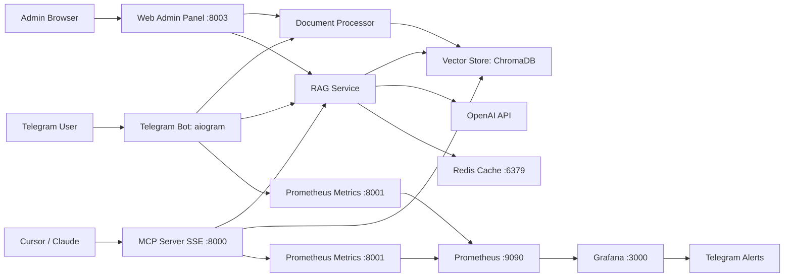

# RAG Telegram Bot (smartass)

[](https://www.python.org/downloads/)
[](https://python.langchain.com/)
[](https://www.trychroma.com/)
[](https://docs.docker.com/compose/)
[](LICENSE)

**Self-hosted Telegram-бот с RAG по PDF/Markdown, MCP SSE для Cursor/Claude и стеком Prometheus + Grafana.**

| Паспорт | |
|---|---|
| **Уровень** | Level 2 — Smart assistant (RAG + память/кэш + MCP; без multi-agent LangGraph) |
| **Статус** | active |
| **Ценность** | Ответы по вашим документам с источниками, админка и observability в одном Compose |
| **Актуализация README** | 2026-08-06 · см. [историю коммитов](https://github.com/kartuznik/smartass/commits/main) |

Операции (deploy, backup/restore, ротация ключей, инциденты, rollback): [docs/RUNBOOK.md](docs/RUNBOOK.md).

> Каталог `docs/` также используется как **хранилище загруженных документов** (PDF/MD). Ops-файлы — `docs/RUNBOOK.md` и `docs/demo/`; пользовательские аплоады при правках документации не трогать.

---

## О проекте

**RAG Telegram Bot** (репозиторий `smartass`) — **portfolio / self-hosted MVP**: семантический поиск по загруженным PDF и Markdown, ответы LLM с источниками, MCP SSE для Cursor/Claude, Redis-кэш повторных запросов, Web Admin Panel и мониторинг Prometheus + Grafana с Telegram-алертами.

### Что умеет

- Загрузка и индексация PDF / Markdown (`.md`) в ChromaDB.
- RAG-ответы в Telegram с источниками и оценкой релевантности.
- MCP tools: `search_docs`, `list_documents`, `get_document_info` (SSE `:8000`).
- Redis-кэш повторных запросов; админ-команда `/doctor` и фоновый `health_check_loop`.
- Web Admin Panel (`:8003`) для документов и кэша.
- Prometheus (`:9090`) + Grafana (`:3000`) + алерты в Telegram.

### Чего не умеет (честный scope)

- Не multi-tenant SaaS и не enterprise IAM (SSO/SAML).
- Нет гарантированного SLA и нет «production-ready enterprise» из коробки.
- Нет multi-agent LangGraph / research-роутера уровня Watchdog (это Level 2, не Level 3).
- Без валидного `OPENAI_API_KEY` embeddings и генерация недоступны — бот не имитирует успешный ответ.
- Конкретные коммерческие цены и офферы живут **вне** git.

### Поведение при сбоях (graceful degradation)

- **OpenAI / embeddings недоступны:** пайплайн логирует ошибку; пользователю — честный отказ, не выдуманный ответ по «памяти».
- **Redis недоступен:** кэш soft-fail (запросы идут в RAG без ускорения), бот продолжает работать.
- **Критичные сбои инфраструктуры:** `/doctor` и фоновый health-loop уведомляют админов (по факту кода).
- **Compose:** сервисы с политикой restart стека; детали — в [docs/RUNBOOK.md](docs/RUNBOOK.md).

---

## Быстрый старт

```bash
git clone https://github.com/kartuznik/smartass.git
cd smartass
cp .env.example .env   # заполните токены и ключи
docker compose up -d --build
docker compose logs -f bot
```

### Ролевые порты

| Роль | Порт |
|---|---|
| MCP SSE | `:8000` |
| Метрики бота (`/metrics`) | `:8001` |
| Метрики MCP (host mapping) | `:8002` |
| Web Admin Panel | `:8003` |
| Prometheus | `:9090` |
| Grafana | `:3000` |
| Redis | `:6379` |

---

## Возможности

### Для клиента (Telegram)

- Загрузка документов, вопросы по корпусу, ответы с источниками.
- Команды: `/start`, `/help`, `/upload`, `/list`, `/delete`, `/stats`.

### Для администратора

- Telegram: `/doctor` (диагностика).
- Web Admin Panel `:8003` — документы и кэш (пароль из `ADMIN_PASSWORD` в `.env`).
- Grafana `:3000` + Prometheus `:9090`; алерты через `TELEGRAM_ALERT_CHAT_ID`.
- MCP для Cursor/Claude на `:8000`.

---

## Архитектура



### Поток данных

1. Пользователь загружает PDF или Markdown (`.md`) в Telegram.
2. Бот извлекает текст, делит на чанки, считает embeddings и пишет в ChromaDB.
3. Вопрос → retrieval релевантных чанков → LLM отвечает с источниками.
4. MCP-клиент вызывает `search_docs` / `list_documents` / `get_document_info` через SSE.
5. Повторные запросы по возможности отдаются из Redis.
6. Администратор управляет файлами и кэшем через web panel.
7. Метрики → Prometheus → Grafana; алерты → Telegram.

---

## Демо

Плейсхолдеры (файлы добавит владелец):

| Плейсхолдер | Сценарий |
|---|---|
| `docs/demo/01-upload.png` | `/upload` документа |
| `docs/demo/02-rag-answer.png` | Ответ с источниками |
| `docs/demo/03-mcp-cursor.png` | MCP в Cursor |
| `docs/demo/04-admin-panel.png` | Web Admin `:8003` |
| `docs/demo/05-grafana.png` | Дашборд Grafana |

Живой демо-бот: ссылку на `@…` добавляет владелец после публикации.

---

## Команды Telegram

| Команда | Описание |
|---|---|
| `/start` | Приветствие и краткая инструкция |
| `/help` | Список команд |
| `/upload` | Загрузка PDF или Markdown |
| `/list` | Список проиндексированных документов |
| `/delete <id>` | Удаление документа |
| `/stats` | Статистика документов/чанков |
| `/doctor` | Диагностика (только админы) |

### MCP (Cursor / Claude)

SSE endpoint (локально / Remote SSH на том же host):

```text
http://localhost:8000/sse
```

Пример конфигурации Cursor:

```json
{
  "mcpServers": {
    "smartass-rag": {
      "url": "http://localhost:8000/sse"
    }
  }
}
```

Инструменты: `search_docs(query, top_k=3)`, `list_documents()`, `get_document_info(document_id)`.

---

## Переменные окружения

| Переменная | Обязательна | Назначение |
|---|---|---|
| `TELEGRAM_BOT_TOKEN` | да | Токен бота |
| `OPENAI_API_KEY` | да | Embeddings и LLM |
| `ADMIN_USER_IDS` | да | Telegram user id админов (через запятую) |
| `TELEGRAM_ALERT_CHAT_ID` | да | Chat id для алертов Grafana |
| `REDIS_URL` | да | Подключение к Redis |
| `ADMIN_PASSWORD` | да | Пароль Web Admin Panel |
| `EMBEDDING_MODEL` / `LLM_MODEL` | нет | Модели (см. `.env.example`) |
| `CHROMA_PERSIST_DIRECTORY` / `DOCS_DIR` / `DATA_DIR` | нет | Пути хранилища |

```bash
cp .env.example .env
# заполните значения локально; не коммитьте .env
```

---

## Установка и деплой

### Docker Compose (рекомендуется)

```bash
git clone https://github.com/kartuznik/smartass.git
cd smartass
cp .env.example .env
docker compose up -d --build
docker compose ps
```

### Локально (venv)

```bash
python3 -m venv .venv
source .venv/bin/activate
pip install -r requirements.txt
cp .env.example .env
python3 -m bot.main
```

Подробности, **backup/restore** (`data/chroma_db`, `data/bot_memory.db`, аплоады в `docs/`), ротация ключей и инциденты — в [docs/RUNBOOK.md](docs/RUNBOOK.md).

Кратко backup: архивировать `data/` и пользовательские файлы в `docs/` (не ops-файлы) — см. runbook.

---

## Мониторинг

| Сервис | Доступ |
|---|---|
| Prometheus | `:9090` |
| Grafana | `:3000` — логин `admin`; пароль только из конфигурации стека (`docker-compose` / env), **не** дублировать в README |
| Bot metrics | `:8001/metrics` |
| MCP metrics (host) | `:8002/metrics` |

Telegram-алерты: задайте `TELEGRAM_BOT_TOKEN` и `TELEGRAM_ALERT_CHAT_ID`, затем:

```bash
docker compose up -d --force-recreate grafana
docker compose logs --tail=100 grafana
```

---

## Решение проблем

| Симптом | Что проверить |
|---|---|
| MCP недоступен | сервис `mcp`, порт `:8000` |
| Пустые RAG-ответы | `OPENAI_API_KEY`, индекс документов |
| Алерты Grafana | provisioning logs, chat/token env |
| Права на томах | `data`, `docs`, `logs` |
| Redis | доступность и `REDIS_URL` |
| Admin login | `ADMIN_PASSWORD` в `.env` (не светить в чат) |

Быстрые проверки: `/doctor` (админ), `docker compose ps`, `curl -s http://localhost:8001/metrics`.

---

## FAQ

**Q: Это production-ready enterprise?**  
A: Нет. Это **portfolio / self-hosted MVP**-ассистент с RAG и мониторингом.

**Q: Где хранятся загруженные файлы?**  
A: Пользовательские аплоады — в `docs/` (корпус). Ops-документация — `docs/RUNBOOK.md` и `docs/demo/`. Векторный индекс — `data/chroma_db`.

**Q: Обязателен ли Redis?**  
A: Для кэша — да по стеку Compose. При недоступности Redis кэш soft-fail, RAG продолжает работать.

**Q: Как подключить Cursor?**  
A: MCP SSE на `http://localhost:8000/sse` (или host:port вашего деплоя без записи IP в git как «канон»).

**Q: Где backup?**  
A: См. [docs/RUNBOOK.md](docs/RUNBOOK.md) — `data/chroma_db`, `data/bot_memory.db`, аплоады в `docs/`.

---

## Тестирование

```bash
pytest tests/ -v --cov=bot --cov=admin_panel
```

---

## Лицензирование и коммерческое использование

Базовая лицензия репозитория — **MIT** (см. [LICENSE](LICENSE)): код можно изучать, форкать и запускать self-hosted.

Коммерческие условия и редакции **Starter**, **Team** и **Custom** доступны **по запросу через контакт** (материалы — вне git). Перевод документации на английский для международного клиента — опция редакции **Custom**, а не постоянный twin в репозитории.

| Редакция | Состав (ориентир) |
|---|---|
| **Community (MIT)** | Self-host RAG-бот, ChromaDB, Redis-кэш, MCP SSE, admin panel, Prometheus/Grafana |
| **Starter** | Community + сопровождение внедрения single-tenant demo |
| **Team** | Starter + усиленные ops/алерты/runbook по договорённости |
| **Custom** | Индивидуальный scope: tenancy, SSO, иной LLM/embedding stack, **локализованный EN-док под клиента** |

Конкретные цены живут **вне** git.

## License

MIT — см. [LICENSE](LICENSE).

## Авторы

- [kartuznik](https://github.com/kartuznik)
